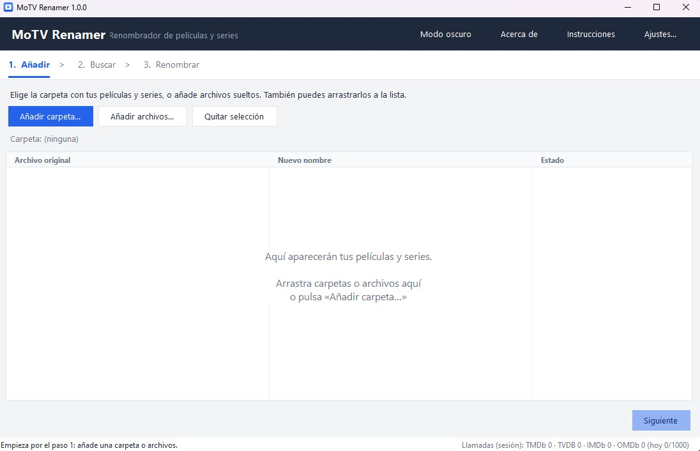

# MoTV Renamer

**Free movie & TV series renamer for Windows — ready for Jellyfin, Plex, Emby and Kodi.**

**English** · [Español](#español)

[**Download MoTVRenamer.exe**](https://github.com/teleonline/MoTVRenamer/releases/latest)

---

Stop fighting with messy file names. MoTV Renamer looks up your movies and series on **TMDb, IMDb, OMDb and TheTVDB** and renames them in the format that **Jellyfin, Plex, Emby and Kodi** recognize, so everything is identified correctly in your library. **No installation needed.**

> For **personal, non-commercial use** only.

## Features

- **3 simple steps:** add → search → rename. Nothing is renamed until you confirm.
- **Undo** the last rename with one click.
- **45+ search languages**, including Catalan and Valencian.
- **Series made easy:** season and episode detection, including double episodes.
- **4 data sources** at once. It works without keys using IMDb; add a free TMDb key for full series support.
- **Drag & drop** folders or files, with *Show in folder* after renaming.
- **Dark and light mode**, English and Spanish interface.
- **Safe by design:** renames in small batches (20 at a time) with progress and cancel, and never overwrites existing files.

## Before → After

| Before | After |
|---|---|
| `Matrix.1999.1080p.BluRay.x264-GRP.mkv` | `Matrix (1999).mkv` |
| `breaking.bad.s01e02.720p.mkv` | `Breaking Bad - S01E02 - Cat's in the Bag....mkv` |
| `dragon ball z s01e02.mkv` | `Dragon Ball Z - S01E02 - The New Threat.mkv` |

Name formats can be changed in **Settings**.

## Download

1. Go to [**Releases**](https://github.com/teleonline/MoTVRenamer/releases/latest) and download `MoTVRenamer.exe`.
2. Run it. That's it (Windows 10/11).

> If Windows SmartScreen warns you, click **More info → Run anyway**. The app is new and unsigned.

## How to use

1. **Add** — choose a folder or files (or drag them in).
2. **Search** — pick the language of your titles and click *Find names*.
3. **Rename** — check the new names and click *Rename*.

For best results, name files like: `Matrix (1999).mkv` · `Series (2020)\Season 01\S01E02.mkv`. More help under **Instructions** inside the app.

## Free API keys (recommended)

It works without keys using IMDb (movies only). For series and better accuracy, get a free key and paste it in **Settings**:
[TMDb](https://www.themoviedb.org/settings/api) · [OMDb](https://www.omdbapi.com/apikey.aspx) · [TheTVDB](https://thetvdb.com/api-information)

## Is it safe?

- It only reads and renames files in the folders you choose, queries TMDb, OMDb, TheTVDB and IMDb, and stores its settings in `%APPDATA%\MoTVRenamer`. **It sends no data anywhere else.**
- All the code is in one readable file: [`MoTVRenamer.cs`](MoTVRenamer.cs). You can review it or build your own `.exe` with `build.bat`.
- Check your download: `certutil -hashfile MoTVRenamer.exe SHA256` must match the value in the release and on [VirusTotal](https://www.virustotal.com/gui/file/34c89adb287dab2d88d359e46b6a866718618ac1f0c6a7973a40ee88be8938aa).
- Some antivirus products flag it because of their **machine-learning** (heuristic) models: being new and unsigned, it resembles other programs by its traits, but **no virus has been detected**. It is a false positive.

## Uninstall

Delete `MoTVRenamer.exe`. To remove your data too, click **Settings → Delete settings** before deleting the program (or remove the `%APPDATA%\MoTVRenamer` folder). It installs nothing else.

## Notice

It only renames files you already have; it does not download or distribute content. Provided “as is”, without warranty: the authors are not responsible for how it is used. It uses TMDb, OMDb, TheTVDB and IMDb but is not endorsed by them. License: [personal, non-commercial use](LICENSE).

## Developers

Single C# file (`MoTVRenamer.cs`). On Windows, run `build.bat` (nothing to install) to produce `MoTVRenamer.exe`.

Made by [teleonline](https://github.com/teleonline) with the help of Claude (Anthropic).

 

# Español

[English](#motv-renamer) · **Español**

---

[**Descargar MoTVRenamer.exe**](https://github.com/teleonline/MoTVRenamer/releases/latest)

¿Cansado de archivos con nombres desordenados? MoTV Renamer busca tus películas y series en **TMDb, IMDb, OMDb y TheTVDB** y las renombra con el formato que reconocen **Jellyfin, Plex, Emby y Kodi**, para que se identifiquen correctamente en tu biblioteca. **Sin instalación.**

> Solo para **uso personal y no comercial**.

### Características

- **3 pasos sencillos:** añadir → buscar → renombrar. No se renombra nada hasta que confirmas.
- **Deshacer** el último renombrado con un clic.
- **Más de 45 idiomas de búsqueda**, incluidos catalán y valenciano.
- **Series fáciles:** detecta temporada y episodio, incluidos los episodios dobles.
- **4 fuentes de datos** a la vez. Funciona sin claves con IMDb; añade una clave gratuita de TMDb para series completas.
- **Arrastra y suelta** carpetas o archivos, con *Ver en carpeta* tras renombrar.
- **Modo oscuro y claro**, interfaz en inglés y español.
- **Seguro por diseño:** renombra en tandas pequeñas (20 a la vez) con progreso y cancelación, y nunca sobrescribe archivos existentes.

### Antes → Después

| Antes | Después |
|---|---|
| `Matrix.1999.1080p.BluRay.x264-GRP.mkv` | `Matrix (1999).mkv` |
| `breaking.bad.s01e02.720p.mkv` | `Breaking Bad - S01E02 - Cat's in the Bag....mkv` |
| `dragon ball z s01e02.mkv` | `Dragon Ball Z - S01E02 - The New Threat.mkv` |

Los formatos de nombre se pueden cambiar en **Ajustes**.

### Descargar

1. Ve a [**Releases**](https://github.com/teleonline/MoTVRenamer/releases/latest) y descarga `MoTVRenamer.exe`.
2. Ábrelo. Ya está (Windows 10/11).

> Si Windows SmartScreen avisa, pulsa **Más información → Ejecutar de todas formas**. El programa es nuevo y no está firmado.

### Cómo se usa

1. **Añadir** — elige una carpeta o archivos (o arrástralos).
2. **Buscar** — elige el idioma de tus títulos y pulsa *Buscar nombres*.
3. **Renombrar** — revisa los nombres y pulsa *Renombrar*.

Para mejores resultados nombra así: `Matrix (1999).mkv` · `Serie (2020)\Season 01\S01E02.mkv`. Más ayuda en **Instrucciones** dentro del programa.

### Claves gratuitas (recomendado)

Funciona sin claves con IMDb (solo películas). Para series y más precisión, consigue una clave gratis y pégala en **Ajustes**:
[TMDb](https://www.themoviedb.org/settings/api) · [OMDb](https://www.omdbapi.com/apikey.aspx) · [TheTVDB](https://thetvdb.com/api-information)

### ¿Es seguro?

- Solo lee y renombra los archivos de las carpetas que eliges, consulta TMDb, OMDb, TheTVDB e IMDb, y guarda sus ajustes en `%APPDATA%\MoTVRenamer`. **No envía datos a ningún otro sitio.**
- Todo el código está en un archivo legible: [`MoTVRenamer.cs`](MoTVRenamer.cs). Puedes revisarlo o crear tu propio `.exe` con `build.bat`.
- Comprueba tu descarga: `certutil -hashfile MoTVRenamer.exe SHA256` debe dar el mismo valor que aparece en la release y en [VirusTotal](https://www.virustotal.com/gui/file/34c89adb287dab2d88d359e46b6a866718618ac1f0c6a7973a40ee88be8938aa).
- Algunos antivirus lo marcan por sus modelos de **aprendizaje automático** (heurística): al ser un programa nuevo y sin firmar, se parece a otros por sus rasgos, pero **no se ha detectado ningún virus**. Es un falso positivo.

### Desinstalar

Borra `MoTVRenamer.exe`. Para quitar también tus datos, pulsa **Ajustes → Borrar ajustes** antes de borrar el programa (o elimina la carpeta `%APPDATA%\MoTVRenamer`). No instala nada más.

### Aviso

Solo renombra archivos que ya tienes; no descarga ni distribuye contenido. Se ofrece «tal cual», sin garantía: los autores no se hacen responsables de su uso. Usa TMDb, OMDb, TheTVDB e IMDb pero no está avalado por ellos. Licencia: [uso personal no comercial](LICENSE).

### Desarrolladores

Un solo archivo C# (`MoTVRenamer.cs`). En Windows, ejecuta `build.bat` (sin instalar nada) para generar `MoTVRenamer.exe`.

Hecho por [teleonline](https://github.com/teleonline) con ayuda de Claude (Anthropic).
