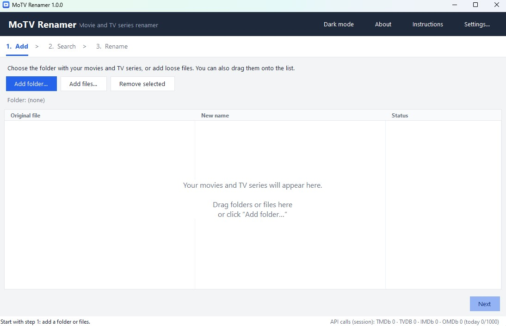

# MoTV Renamer

**Español** · [English](#english)

Renombrador **gratuito** de películas y series. Solo para **uso personal, no comercial**.

## Descargar

1. Ve a [**Releases**](https://github.com/teleonline/MoTVRenamer/releases/latest) y descarga `MoTVRenamer.exe`.
2. Ábrelo. No necesita instalación (Windows 10/11).

> Si Windows SmartScreen avisa, pulsa **Más información → Ejecutar de todas formas**. El programa es nuevo y no está firmado.

## Cómo se usa

1. **Añadir**: elige una carpeta o archivos (o arrástralos).
2. **Buscar**: elige el idioma de tus títulos y pulsa *Buscar nombres*.
3. **Renombrar**: revisa los nombres y pulsa *Renombrar*. Se puede deshacer.

Para mejores resultados nombra así: `Matrix (1999).mkv` · `Serie (2020)\Season 01\S01E02.mkv`. Más ayuda en **Instrucciones** dentro del programa.

## Claves gratuitas (recomendado)

Funciona sin claves con IMDb (solo películas). Para series y más precisión, consigue una clave gratis y pégala en **Ajustes**: [TMDb](https://www.themoviedb.org/settings/api) · [OMDb](https://www.omdbapi.com/apikey.aspx) · [TheTVDB](https://thetvdb.com/api-information)

## ¿Es seguro?

- Solo lee y renombra los archivos de las carpetas que eliges, consulta TMDb, OMDb, TheTVDB e IMDb, y guarda sus ajustes en `%APPDATA%\MoTVRenamer`. No envía datos a ningún otro sitio.
- Todo el código está en un archivo legible: [`MoTVRenamer.cs`](MoTVRenamer.cs). Puedes revisarlo o crear tu propio `.exe` con `build.bat`.
- Comprueba tu descarga: `certutil -hashfile MoTVRenamer.exe SHA256` debe dar el mismo valor que aparece en la release y en [VirusTotal](https://www.virustotal.com/gui/file/34c89adb287dab2d88d359e46b6a866718618ac1f0c6a7973a40ee88be8938aa).
- Algunos antivirus lo marcan por sus modelos de **aprendizaje automático** (heurística): al ser un programa nuevo y sin firmar, se parece a otros por sus rasgos, pero **no se ha detectado ningún virus**. Es un falso positivo; ya lo hemos reportado.

## Desinstalar

Borra `MoTVRenamer.exe`. Para quitar también tus datos, pulsa **Ajustes → Borrar ajustes** antes de borrar el programa (o elimina la carpeta `%APPDATA%\MoTVRenamer`). No instala nada más.

## Aviso

Solo renombra archivos que ya tienes; no descarga ni distribuye contenido. Se ofrece «tal cual», sin garantía: los autores no se hacen responsables de su uso. Usa TMDb, OMDb, TheTVDB e IMDb pero no está avalado por ellos. Licencia: [uso personal no comercial](LICENSE).

## Desarrolladores

Un solo archivo C# (`MoTVRenamer.cs`). En Windows, ejecuta `build.bat` (sin instalar nada) para generar `MoTVRenamer.exe`. Hecho por [teleonline](https://github.com/teleonline) con ayuda de Claude (Anthropic).

---

## English

**Free** movie and TV series renamer. For **personal, non-commercial use** only.

### Download

1. Go to [**Releases**](https://github.com/teleonline/MoTVRenamer/releases/latest) and download `MoTVRenamer.exe`.
2. Run it. No installation needed (Windows 10/11).

> If Windows SmartScreen warns you, click **More info → Run anyway**. The app is new and unsigned.

### How to use

1. **Add**: choose a folder or files (or drag them in).
2. **Search**: pick the language of your titles and click *Find names*.
3. **Rename**: check the names and click *Rename*. It can be undone.

For best results name files like: `Matrix (1999).mkv` · `Series (2020)\Season 01\S01E02.mkv`. More help under **Instructions** inside the app.

### Free API keys (recommended)

Works without keys using IMDb (movies only). For series and better accuracy, get a free key and paste it in **Settings**: [TMDb](https://www.themoviedb.org/settings/api) · [OMDb](https://www.omdbapi.com/apikey.aspx) · [TheTVDB](https://thetvdb.com/api-information)

### Is it safe?

- It only reads and renames files in the folders you choose, queries TMDb, OMDb, TheTVDB and IMDb, and stores its settings in `%APPDATA%\MoTVRenamer`. It sends no data anywhere else.
- All the code is in one readable file: [`MoTVRenamer.cs`](MoTVRenamer.cs). You can review it or build your own `.exe` with `build.bat`.
- Check your download: `certutil -hashfile MoTVRenamer.exe SHA256` must match the value in the release and on [VirusTotal](https://www.virustotal.com/gui/file/34c89adb287dab2d88d359e46b6a866718618ac1f0c6a7973a40ee88be8938aa).
- Some antivirus products flag it because of their **machine-learning** (heuristic) models: being new and unsigned, it resembles other programs by its traits, but **no virus has been detected**. It is a false positive, and it has been reported.

### Uninstall

Delete `MoTVRenamer.exe`. To remove your data too, click **Settings → Delete settings** before deleting the program (or remove the `%APPDATA%\MoTVRenamer` folder). It installs nothing else.

### Notice

It only renames files you already have; it does not download or distribute content. Provided “as is”, without warranty: the authors are not responsible for how it is used. It uses TMDb, OMDb, TheTVDB and IMDb but is not endorsed by them. License: [personal, non-commercial use](LICENSE).

### Developers

Single C# file (`MoTVRenamer.cs`). On Windows, run `build.bat` (nothing to install) to produce `MoTVRenamer.exe`. Made by [teleonline](https://github.com/teleonline) with the help of Claude (Anthropic).
